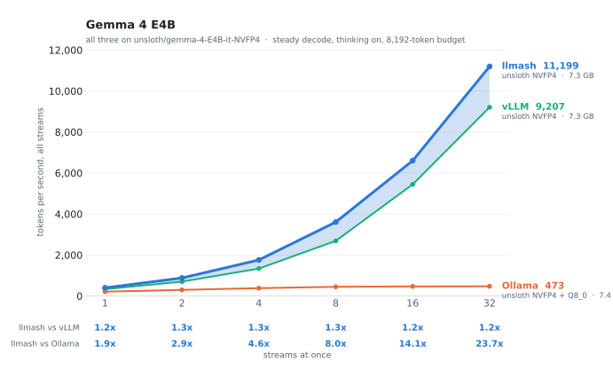
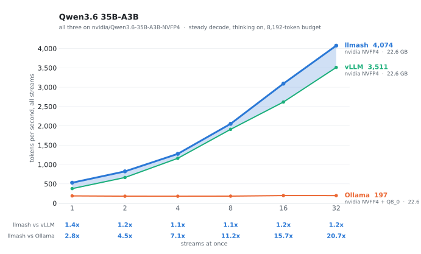
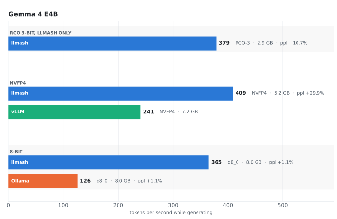
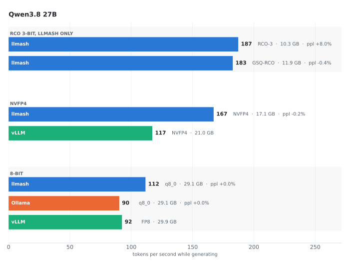
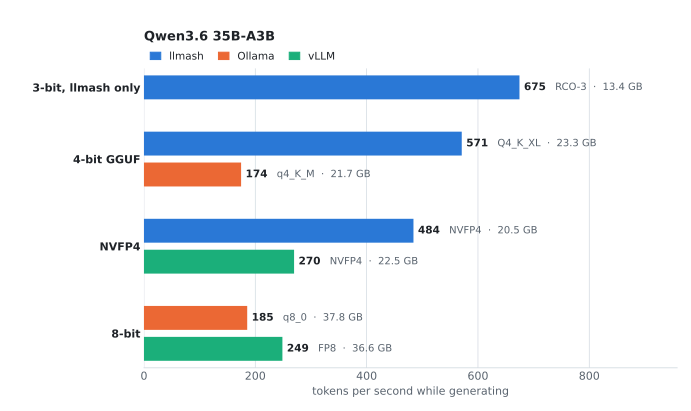
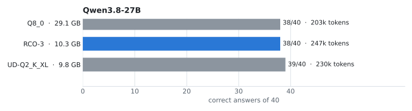
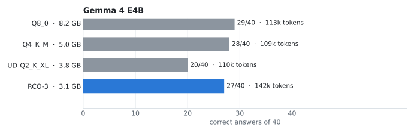
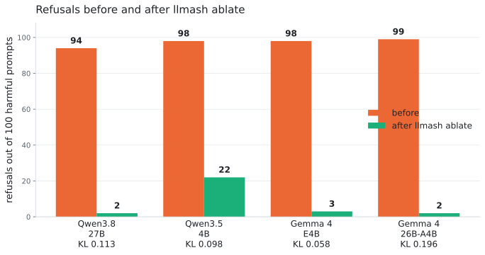

# llmash

[](https://github.com/omgitsbase/llmash/releases/latest)
[](https://github.com/omgitsbase/llmash/blob/main/LICENSE)
[](https://github.com/omgitsbase/llmash/releases/latest)
[](https://github.com/omgitsbase/llmash/releases/latest)
[](https://isocpp.org)
[](https://developer.nvidia.com/cuda-toolkit)
[![Ask DeepWiki](https://img.shields.io/badge/DeepWiki-omgitsbase%2Fllmash-blue.svg?logo=)](https://deepwiki.com/omgitsbase/llmash)
[](https://discord.com/users/1274629090346926121)

An Ollama-compatible server and command line for Windows and Linux, on a fork
of llama.cpp. It keeps Ollama's commands, API and model store. It replaces the
runtime, the launch settings and the drafter, and can assemble a build when a
repository has none at the wanted size.

## Contents

- [Install](#install)
- [Performance](#performance)
- [Weight formats](#weight-formats)
- [The runtime](#the-runtime)
- [Models and pulling](#models-and-pulling)
- [Classifiers](#classifiers)
- [Context](#context)
- [Custom builds](#custom-builds)
- [Abliteration](#abliteration)
- [Speculation](#speculation)
- [Commands](#commands)
- [Configuration](#configuration)
- [Building](#building)

## Install

Windows, in PowerShell:

```powershell
irm https://raw.githubusercontent.com/omgitsbase/llmash/main/install.ps1 | iex
```

Linux:

```sh
curl -fsSL https://raw.githubusercontent.com/omgitsbase/llmash/main/install.sh | sh
```

A normal window installs for the current user. An admin PowerShell, or
`sudo sh` on Linux, installs for the machine. The installer takes the latest
release. `llmash update` takes the latest push to main (the `edge` build), or
the latest release with `--stable`. `ollama` is installed as an alias of
`llmash`.

The installer puts `llmash` on PATH, fetches the runtime for the hardware and
starts the server. An NVIDIA card from Turing (RTX 20) on with driver 580 or
newer gets llmash's CUDA 13 runtime; anything else gets upstream llama.cpp's
Vulkan or CPU build, and models load into system RAM.

| | Windows | Linux |
|---|---|---|
| Runtime | llmash CUDA 13, else Vulkan or CPU | llmash CUDA 13, else Vulkan or CPU |
| Runs as | tray app, starts at login | user service; as root, a system service under its own `llmash` account (`--no-service` to skip) |
| Installs to | `%LOCALAPPDATA%\llmash`; from an admin window, `%ProgramData%\llmash` | `~/.local/lib/llmash`; as root, `/usr/local/lib/llmash` |
| Options | `-NoOllama`, `-Runtime`, `-Dir`, `-Yes` | `--no-ollama`, `--runtime`, `--user`, `--system`, `--uninstall` |

A machine install is usable by every user and writable by administrators only.
On Linux the service runs as the `llmash` account, with models in
`/var/lib/llmash/models` unless a folder is already set. `link.json`, which
holds the key for `llmash link`, is readable by its owner alone: mode 0600 on
Linux; the user, SYSTEM and Administrators on Windows. `llmash update` applies
this to installs made by older versions. An install takes its settings from one
it replaces.

Over SSH, or from a script on Windows, save the installer and pass options on
the command line; with none it lists them:

```powershell
irm https://raw.githubusercontent.com/omgitsbase/llmash/main/install.ps1 -OutFile install.ps1
powershell -ExecutionPolicy RemoteSigned -File .\install.ps1 -NoOllama
```

## Performance

### Batching

Tokens per second of all streams together, from one stream to 32 at once, with
llmash, vLLM and Ollama on the same NVFP4 checkpoint. The fill is llmash's lead
over vLLM; the rows under each chart are llmash's speed over the other two at
each level.

| model | checkpoint | llmash | vLLM | Ollama |
|---|---|---|---|---|
| Gemma 4 E4B | `unsloth/gemma-4-E4B-it-NVFP4` | GGUF, every weight's bytes kept, 7.3 GB | the checkpoint | GGUF, the FP8 layers as Q8_0, 7.4 GB |
| Qwen3.6 35B-A3B | `nvidia/Qwen3.6-35B-A3B-NVFP4` | GGUF, every weight's bytes kept, 22.6 GB | the checkpoint | GGUF, the FP8 layers as Q8_0, 22.7 GB |

vLLM reads safetensors and no GGUF. Ollama reads GGUF and has no FP8 type, so
its copy keeps the checkpoint's NVFP4 layers and stores the FP8 ones as Q8_0;
the "Ollama's file" row of each table is llmash on that same file.
`convert_hf_to_gguf.py --fp8` writes llmash's copy, `--fp8-as-q8` Ollama's.

- Drafting: llmash and vLLM 3 tokens a round, with Google's assistant drafter
  (BF16 on both) for Gemma and the checkpoint's own MTP head for Qwen. Ollama as
  its own tags ship: its copy of the assistant, 3 tokens, for Gemma; the MTP
  head, 2 tokens, for Qwen. Drafting changes how fast tokens come, not which.
- Cache: both checkpoints declare an FP8 cache. llmash and vLLM keep it in FP8
  with the checkpoint's scales (1.0 for nvidia's, which ships none), Ollama in
  f16, its default.
- Workload: a decode saturation suite. C requests of
  `long_decode_aime26_15` released together, thinking on, an 8,192-token
  budget, distinct seeds, temperature 0.6, top-p 0.95, top-k 20, presence
  penalty 1.0, no prefix reuse.
- A point is steady decode: the tokens of the one-second windows in which all C
  streams generate and no prompt is computed. From llmash's step log, vLLM's
  `/metrics`, and for Ollama, which has no step counters, the arrival of each
  streamed token. Replies end at their own length; `bench/scaling.json` has
  each wave's makespan, token count and finish reasons.
- One server per provider and model, sized for 32 streams, takes the levels in
  turn after a warm-up request. Ollama runs with `OLLAMA_NUM_PARALLEL=32` (its
  default of 1 queues requests) and its other defaults. For Qwen3.6 35B-A3B it
  logs "model architecture does not currently support parallel requests" and
  serves one request at a time whatever the setting, so no window has every
  stream generating; its points past one stream are the wave's tokens over its
  makespan.
- RTX PRO 6000 Blackwell (96 GB), Windows 11, the card also driving the
  display. llmash native, runtime build 777 (fork commit
  [`5070592c8`](https://github.com/omgitsbase/llama.cpp/commit/5070592c8));
  vLLM (`vllm/vllm-openai` 0.32.0) and Ollama (`ollama/ollama` 0.40.11) in
  their Linux images under WSL2, on the same driver. llmash measured on
  2026-10-30, vLLM and Ollama on 2026-10-29, one wave per point; repeated waves
  differ by about 3%.

<!-- SCALING -->

#### Gemma 4 E4B

<picture>
  <source media="(prefers-color-scheme: dark)" srcset="docs/scale-gemma-4-e4b-dark.svg">
  
</picture>

| provider | file | weights | 1 | 2 | 4 | 8 | 16 | 32 |
|---|---|--:|--:|--:|--:|--:|--:|--:|
| llmash | unsloth/gemma-4-E4B-it-NVFP4, every weight's bytes kept | 7.3 GB | 410 | 884 | 1,744 | 3,673 | 6,545 | 11,036 |
| vLLM | unsloth/gemma-4-E4B-it-NVFP4, the checkpoint | 7.3 GB | 335 | 702 | 1,338 | 2,690 | 5,446 | 9,207 |
| Ollama | unsloth/gemma-4-E4B-it-NVFP4, the FP8 layers as Q8_0 | 7.4 GB | 211 | 299 | 382 | 449 | 467 | 473 |
| llmash | Ollama's copy: the FP8 layers as Q8_0 | 7.4 GB | 404 | 821 | 1,488 | 3,047 | 5,229 | 8,292 |
| llmash over vLLM, same checkpoint | | | 1.23x | 1.26x | 1.30x | 1.37x | 1.20x | 1.20x |
| llmash over Ollama, same checkpoint | | | 1.95x | 2.96x | 4.56x | 8.18x | 14.00x | 23.32x |

#### Qwen3.6 35B-A3B

<picture>
  <source media="(prefers-color-scheme: dark)" srcset="docs/scale-qwen3-6-35b-a3b-dark.svg">
  
</picture>

| provider | file | weights | 1 | 2 | 4 | 8 | 16 | 32 |
|---|---|--:|--:|--:|--:|--:|--:|--:|
| llmash | nvidia/Qwen3.6-35B-A3B-NVFP4, every weight's bytes kept | 22.6 GB | 510 | 774 | 1,214 | 1,936 | 2,985 | 4,103 |
| vLLM | nvidia/Qwen3.6-35B-A3B-NVFP4, the checkpoint | 22.6 GB | 377 | 664 | 1,161 | 1,910 | 2,616 | 3,511 |
| Ollama | nvidia/Qwen3.6-35B-A3B-NVFP4, the FP8 layers as Q8_0 | 22.6 GB | 189 | 181 | 181 | 183 | 197 | 197 |
| llmash | Ollama's copy: the FP8 layers as Q8_0 | 22.6 GB | 539 | 762 | 1,167 | 1,814 | 2,722 | 3,536 |
| llmash over vLLM, same checkpoint | | | 1.35x | 1.16x | 1.05x | 1.01x | 1.14x | 1.17x |
| llmash over Ollama, same checkpoint | | | 2.70x | 4.27x | 6.72x | 10.60x | 15.12x | 20.86x |

<!-- /SCALING -->

### One stream at a time

One RTX PRO 6000 Blackwell (96 GB), Linux, one request at a time.
`bench/bench.py` sends three workloads (conversation, coding, thinking), three
prompts each, greedy, 600 tokens, streamed. Speed is tokens per second from the
first streamed token to the last, the median of the three prompts; a bar is the
mean of the three workloads. llmash 0.5.7 (runtime build 770) and Ollama
0.40.11 were measured on 2026-10-26, vLLM (`vllm/vllm-openai:latest` as of
2026-09-27) on 2026-09-27 on the same card, its checkpoints unchanged since.
The Gemma 4 E4B rows of llmash were measured again on 2026-10-27 with the
runtime from fork commit
[`669eae10d`](https://github.com/omgitsbase/llama.cpp/commit/669eae10d), now
in runtime build 776: Gemma's assistant drafts a whole round as one graph,
and its per-layer tables sit in pinned host memory the card reads in place
instead of in VRAM.
One run per row, no concurrent load, temperature 0 only, and the card also
drives the display.

Three formats per model:

- 8-bit: llmash and Ollama run the same file, Ollama's own `q8_0` pull. Ollama's
  runner is upstream llama.cpp's server, so these rows are also this fork
  against upstream under Ollama's flags. vLLM runs the FP8 checkpoint.
- NVFP4: llmash runs an NVFP4 GGUF, vLLM an NVFP4 checkpoint. Different files;
  the GGUF is smaller (17.1 against 21.0 GB on the 27B), and a single stream is
  limited by the bytes read per token.
- RCO-3: llmash's own 3-bit build, assembled by `pull`
  ([Custom builds](#custom-builds)).
  `llmash pull hf.co/bartowski/google_gemma-4-E4B-it-GGUF --quant RCO-3`
  reproduces the Gemma 4 E4B file.

Drafting, from each provider's flags and logs:

| provider | Qwen3.8 27B, Qwen3.6 35B-A3B | Gemma 4 E4B |
|---|---|---|
| llmash | the file's MTP head, 3 tokens a round | Google's assistant drafter, 3 tokens a round |
| Ollama | the file's MTP head, 4 tokens a round (`--spec-type draft-mtp --spec-draft-n-max 4`) | none; the `q8_0` tag ships no drafter |
| vLLM | the file's MTP head, 3 tokens a round (`--speculative-config '{"method":"mtp","num_speculative_tokens":3}'`) | the assistant drafter, 3 tokens a round (`gemma4_mtp`) |

The runtime alone: Gemma 4 E4B's `q8_0` on llmash with no drafter of any kind
does 192 tokens a second; Ollama does 126 on the same file; llmash with the
assistant drafter does 391.

Other settings are each provider's defaults: Ollama `-c 262144 -b 512 -ub 512`,
llmash `-c 8192 -b 4096 -ub 2048` plus what it picks per model, vLLM
`--max-model-len 8192`. Ollama applies its own chat template, so its replies
differ in length from llmash's (Gemma 4 E4B conversation: 410 to 459 tokens
against 255 to 324); every reply's token count is in `bench/providers.json`.
Acceptance rates were not recorded.

Perplexity: wikitext-2 as raw text, 2048-token windows, 123k tokens,
`llama-perplexity` from build 770, for every GGUF row and for the model's own
BF16 weights. Only the gap to BF16 means anything, and a gap under about 1% is
within the measurement's error. vLLM's checkpoints are not
GGUFs and have none.

<!-- PROVIDERS -->

#### Gemma 4 E4B

<picture>
  <source media="(prefers-color-scheme: dark)" srcset="docs/speed-gemma-4-e4b-dark.svg">
  
</picture>

| format | provider | file | weights | perplexity | vs BF16 | conversation | coding | thinking |
|---|---|---|--:|--:|--:|--:|--:|--:|
| RCO 3-bit, llmash only | llmash | assembled here from bartowski/google_gemma-4-E4B-it-GGUF bf16 | 2.9 GB | 51.95 | +10.7% | 322 | 477 | 556 |
| NVFP4 | llmash | FreedomAISVR/Gemma-4-E4B-it-NVFP4-GGUF | 5.2 GB | 60.95 | +29.9% | 346 | 500 | 581 |
| NVFP4 | vLLM | unsloth/gemma-4-E4B-it-NVFP4 | 7.2 GB | - | - | 191 | 251 | 281 |
| 8-bit | llmash | Ollama's gemma4:e4b-it-q8_0 | 8.0 GB | 47.44 | +1.1% | 278 | 421 | 474 |
| 8-bit | Ollama | Ollama's gemma4:e4b-it-q8_0 | 8.0 GB | 47.44 | +1.1% | 121 | 127 | 128 |

The model's own BF16 weights measure 46.92 on the same text with the same runtime.

#### Qwen3.8 27B

<picture>
  <source media="(prefers-color-scheme: dark)" srcset="docs/speed-qwen3-8-27b-dark.svg">
  
</picture>

| format | provider | file | weights | perplexity | vs BF16 | conversation | coding | thinking |
|---|---|---|--:|--:|--:|--:|--:|--:|
| RCO 3-bit, llmash only | llmash | assembled here by pull from unsloth/Qwen3.8-27B-GGUF | 10.3 GB | 6.40 | +8.0% | 178 | 187 | 197 |
| RCO 3-bit, llmash only | llmash | ISTA-DASLab's Qwen3.8-27B GSQ-RCO IQ3_S | 11.9 GB | 5.90 | -0.4% | 184 | 172 | 192 |
| NVFP4 | llmash | cdiamond/Qwen3.8-27B-iMatrix-NVFP4-MTP-GGUF | 17.1 GB | 5.92 | -0.2% | 159 | 157 | 185 |
| NVFP4 | vLLM | nvidia/Qwen3.8-27B-NVFP4 | 21.0 GB | - | - | 111 | 115 | 125 |
| 8-bit | llmash | Ollama's qwen3.8:27b-mtp-q8_0 | 29.1 GB | 5.93 | +0.0% | 109 | 102 | 124 |
| 8-bit | Ollama | Ollama's qwen3.8:27b-mtp-q8_0 | 29.1 GB | 5.93 | +0.0% | 73 | 95 | 102 |
| 8-bit | vLLM | Qwen/Qwen3.8-27B-FP8 | 29.9 GB | - | - | 88 | 94 | 95 |

The model's own BF16 weights measure 5.93 on the same text with the same runtime.

#### Qwen3.6 35B-A3B

<picture>
  <source media="(prefers-color-scheme: dark)" srcset="docs/speed-qwen3-6-35b-a3b-dark.svg">
  
</picture>

| format | provider | file | weights | perplexity | vs BF16 | conversation | coding | thinking |
|---|---|---|--:|--:|--:|--:|--:|--:|
| RCO 3-bit, llmash only | llmash | assembled here by pull from unsloth/Qwen3.6-35B-A3B-GGUF | 13.4 GB | 5.90 | +4.0% | 622 | 707 | 733 |
| NVFP4 | llmash | michaelw9999/Qwen3.6-35B-A3B-NVFP4-MTP-GGUF (HQ) | 20.5 GB | 5.78 | +1.8% | 455 | 520 | 551 |
| NVFP4 | vLLM | nvidia/Qwen3.6-35B-A3B-NVFP4 | 22.5 GB | - | - | 252 | 270 | 287 |
| 8-bit | llmash | Ollama's qwen3.6:35b-a3b-mtp-q8_0 | 37.8 GB | 5.66 | -0.3% | 417 | 448 | 515 |
| 8-bit | Ollama | Ollama's qwen3.6:35b-a3b-mtp-q8_0 | 37.8 GB | 5.66 | -0.3% | 162 | 185 | 181 |
| 8-bit | vLLM | Qwen/Qwen3.6-35B-A3B-FP8 | 36.6 GB | - | - | 223 | 252 | 270 |

The model's own BF16 weights measure 5.67 on the same text with the same runtime.

<!-- /PROVIDERS -->

Weights are the text model's only. Drafting accepts more on coding and thinking
than on conversation.

### Math accuracy of the 3-bit builds

Forty questions, ten each from GSM8K, MATH level 3, MATH level 5 and AIME 2025.
Thinking on, each family's recommended sampling, one seed per question, graded
on the final `\boxed{}` answer. Forty questions separate builds only by several
answers; a 2-bit build scoring 39 to Q8_0's 38 is within that noise. The RCO-3
builds generated 21% (Qwen3.8-27B) and 25% (Gemma 4 E4B) more tokens than Q8_0.

<!-- MATH -->

#### Qwen3.8-27B

<picture>
  <source media="(prefers-color-scheme: dark)" srcset="docs/math-qwen3-8-27b-dark.svg">
  
</picture>

| build | size | GSM8K | MATH L3 | MATH L5 | AIME 2025 | total | tokens |
|---|--:|--:|--:|--:|--:|--:|--:|
| Q8_0 | 29.1 GB | 9/10 | 10/10 | 10/10 | 9/10 | 38/40 | 203k |
| RCO-3 | 10.3 GB | 9/10 | 10/10 | 10/10 | 9/10 | 38/40 | 247k |
| UD-Q2_K_XL | 9.8 GB | 9/10 | 10/10 | 10/10 | 10/10 | 39/40 | 230k |

#### Gemma 4 E4B

<picture>
  <source media="(prefers-color-scheme: dark)" srcset="docs/math-gemma-4-e4b-dark.svg">
  
</picture>

| build | size | GSM8K | MATH L3 | MATH L5 | AIME 2025 | total | tokens |
|---|--:|--:|--:|--:|--:|--:|--:|
| Q8_0 | 8.2 GB | 8/10 | 9/10 | 10/10 | 2/10 | 29/40 | 113k |
| Q4_K_M | 5.0 GB | 9/10 | 9/10 | 9/10 | 1/10 | 28/40 | 109k |
| UD-Q2_K_XL | 3.8 GB | 7/10 | 6/10 | 6/10 | 1/10 | 20/40 | 110k |
| RCO-3 | 3.1 GB | 7/10 | 9/10 | 10/10 | 1/10 | 27/40 | 142k |

<!-- /MATH -->

## Weight formats

`pull` lists a repository's builds with these rows picked out:

| Row | What it is | When it is offered |
|---|---|---|
| `rco` | a published GSQ-RCO build: learned 3-bit grids, one type per tensor | the hub has one for the model |
| `custom` | an RCO build assembled here: 3 bits, one type per tensor | always, for a model with no published one |
| `medium` | NVFP4 when every card is sm_120 (0.5.0 and up), from another repository of the same model when this one has none (0.5.1 and up); otherwise Q4_K_M or the nearest 4-bit build | always |
| `large` | Q8_0, or the nearest 6-8 bit build | always |

NVFP4 stores weights as 4-bit floats with an FP8 scale per 16 values. Cards of
compute capability 12.0 (sm_120: RTX 50 series, Blackwell RTX PRO) run it on
their FP4 tensor cores. A B200 is sm_100, which this runtime's FP4 kernels are
not built for. On a dense model, Qwen3.8-27B NVFP4 generates 2-14% faster than
the UD-Q4_K_XL build of the same size and reads a long prompt 31% faster. On a
mixture-of-experts model it reads prompts at the same rate as Q4 and can
generate slower, depending on what the file keeps at higher precision. Where
every card is sm_120 the medium row is an NVFP4 build when the repository, or
another repository's GGUF of the same model, has one, in place of an MXFP4
build; other machines get an MXFP4 build, found the same way, in its own row.
Older cards decode NVFP4 in software and run a Q4_K_M faster. `LLMASH_FP4=1`
or `0` overrides the detection.

```
qwen3.8-27b, which build?
  rco      GSQ-RCO IQ3_S             11.9 GB
> medium   NVFP4, FP8 quality        17.1 GB
  large    Q8_0                      29.1 GB
  ↑↓ move   enter choose   a all builds
```

## The runtime

A llama.cpp fork, fetched beside the program by the installer and refreshed by
`llmash update` when a release carries a newer one. Source:
[omgitsbase/llama.cpp](https://github.com/omgitsbase/llama.cpp), branch
`llmash`; runtime build 777 is commit `5070592c8`. Changes from upstream:

- One CUDA graph per speculative round: the verify batch, the accept decision
  and every draft step, with the accept decided on the GPU.
- Many streams at once: every stream sampled in one step on the GPU, FP4 and
  FP8 GEMMs for a verify over several sequences, attention per sequence over
  its own cells, an MTP drafter's cache kept a stream per sequence, and the FP8
  cache a checkpoint declares (`LLMASH_KV=auto`, the default).
- Recurrent state in BF16 for the delta-net and RWKV models, as vLLM keeps it.
- Draft head: an MTP head drafts through the 131,072 most frequent rows of the
  LM head, requantized to Q4_K at load. Verification reads the full head.
- Fused recurrent layers (Qwen3.5, 3.6, 3.8 and the Next models): the input
  projection runs the causal convolution, its SiLU and the state snapshots in
  its own store; the gating projections run as one launch; the gated norm is
  quantized straight into the output projection's input.
- Fused mixture-of-experts tails: the expert matvec applies the router weights
  as it stores; a residual add rides the output projection it follows.
- Mixture-of-experts layers over several streams: a shared expert shaped like
  the routed ones is loaded as one more expert slot (no extra memory) and runs
  in the expert kernels; gate and up run as one launch over one sort of the
  expert ids and one quantization of the activations, and the down projection
  reuses the sort.
- Small weights over a few sequences' rows (a router, a gating projection)
  split their K across the SMs and sum the parts in a fixed order.
- NVFP4 under speculation: the second-level scales, per expert or per tensor,
  ride the matvecs of a verify batch as they do for one token, so the expert
  gate and up still fuse, and a float gate and up pair runs as one launch.
- Every fusion is matched on the graph, not by model name. Each has a bit in
  `GGML_CUDA_FUSE_OFF` that turns it off.

Through build 770 each release's runtime was checked for the same greedy text as
the previous one on dense, mixture-of-experts and delta-net models, across
NVFP4, 3-bit and 4-bit builds, with MTP and n-gram drafting, and on 1, 2 and 3
GPUs under layer split. Build 776 changes the text on purpose: the BF16
recurrent state (wikitext-2 perplexity of Qwen3.6 35B-A3B 5.8651 against 5.8716
with F32 state) and the FP8 cache where a checkpoint declares one. Build 777
moves the numbers slightly: a shared expert goes through the expert kernels'
quantization and small products sum in another order (perplexity 5.8791, 5.8751
with the shared expert computed apart). Each release's notes list what it was
checked with.

## Models and pulling

Models on the machine are found without setup: every Ollama store (the default
one, `OLLAMA_MODELS`, and any folder shaped like one at the top of a drive), LM
Studio's folders, the Hugging Face and llama.cpp download caches, Jan's and
GPT4All's folders, and a top-level folder on any drive named `models`, `gguf`,
`llm` or similar. They are read in place, subfolders included. Nothing is copied
or deleted and `rm` does not touch them. `llmash models` lists every folder read
and why; `llmash models ignore <folder>` drops one; `llmash models set <folder>`
makes a folder of GGUFs the main one (the same setting as `OLLAMA_MODELS`):

```powershell
llmash models set D:\models
```

`pull` takes an Ollama name or a Hugging Face repository as `hf.co/<org>/<repo>`,
lists its builds and asks which. `hf.co/<org>/<repo>@<quant>` or `--quant`
names one. A width asked for by name is required: when the repository lacks it,
the pull stops and lists what it has. A repository with no GGUF is answered only
by a GGUF conversion of that exact model, never a fine-tune, merge or
abliteration; when there is none, the pull says so and lists the near matches as
different models. Files come down over several connections inside the server,
so closing the terminal does not stop a pull. A gated repository is read with
the token from `hf auth login` or `HF_TOKEN`; the token is sent to the hub only.
A build named without a width (`-APEX-Balanced`, `gemma-2b.gguf`) is listed by
what sets it apart and taken by that name.

`rm` takes a model's full name or any part of it: `llmash rm qwen` removes the
one model with qwen in its name; when several match it lists them and removes
none.

## Classifiers

A classifier answers questions about a text from one forward pass and generates
nothing (0.5.2 and up). The hub tags them `text-classification`: decision models
such as Laya, Jev-Style and decider, and rerankers with a scoring head. `pull`
records the tag and takes what the repository publishes for reading the
answers: Laya's decision head is fetched as a sidecar beside the encoder; a
verdict or answer-letter model gets its readout written to
`<model>.classifier.json`; a scoring head inside the GGUF needs nothing more. A
model pulled earlier gets the same the first time it is shown or run. `show`
lists such a model with the capability `classification`.

`run` on a classifier takes questions first, one per line, then judges every
line of text against them:

```
>>> Which team should handle this? [billing, technical, sales]
>>> score: How urgent is it? [not at all, slightly, very]
>>> Is the customer angry?
>>> I was charged twice for my subscription this month and nobody answers.
Which team should handle this?  billing 91%  ·  technical 6%  ·  sales 3%
score: How urgent is it?        1.7 of 0-2  ·  not at all 4%  ·  slightly 22%  ·  very 74%
Is the customer angry?          yes 83%
```

A choice lists its options in brackets; `name: description` describes one;
`score:` lists ordered levels, lowest first; a question with no options is
answered yes or no. The same lines work in any chat client pointed at llmash,
after the text or in the system prompt, and `/api/chat`, `/api/generate` and
`/v1/chat/completions` answer with the lines above plus an `answers` object.
`POST /api/classify` (also `/v1/systemone`) takes the questions as JSON:

```json
{"model": "laya:q8_0",
 "state": "I was charged twice for my subscription this month.",
 "questions": {"team": {"type": "choice", "instructions": "Which team should handle this?",
                        "criteria": {"billing": "payments, invoices, refunds", "technical": "bugs and outages"}},
               "urgent": {"type": "score", "instructions": "How urgent is it?",
                          "criteria": ["not at all", "slightly", "very"]},
               "angry": {"type": "noul", "instructions": "Is the customer angry?"}}}
```

It answers `{"answers": {"team": {"type": "choice", "choice": "billing", "probabilities": {...}, "confidence": 0.8}, ...}}`.
`state` may be an object. A chat model asked on `/api/classify` is read at the
answer letter of the common decision prompt, which works less well than a model
trained for it. `<model>.classifier.json` beside a GGUF says how a model is read.

## Context

A model runs at 8192 tokens unless the request's `num_ctx`, `llmash ctx`, or
the `num_ctx` in an Ollama model's Modelfile asks for more. Past its trained
context it runs under YaRN, up to four times the trained length.

```
llmash ctx qwen3.8-27b:rco-3 768k --keep
qwen3.8-27b:rco-3 runs at 768k (YaRN x3 over the trained 256k); 59 GB on the card at f16, 92 free
loading and keeping it ... loaded
```

`--kv q8_0` halves the cache; `--keep` holds the model loaded. The cost is
computed from the model's header: how many layers attend over the whole
context, how many heads they keep, and what a recurrent or windowed layer holds
instead. On Windows every video allocation is backed by commit charge (RAM plus
pagefile); llmash reads that figure and `ctx` reports when a window exceeds it.

## Custom builds

`pull` lists a build assembled on this machine beside the published ones. Every
tensor is measured at each candidate type and given the one with the most
accuracy per byte under a size budget. The measure is imatrix-weighted weight
error; the budget is met by bisection on one Lagrange multiplier; only the
output head and the embedding keep a floor. The ladder is 2.4, 2.75 and 3 bits
a weight.

This is the allocation idea of the published GSQ-RCO method, run with ggml's
quantizers. llmash does not implement GSQ's learned grids, and GSQ-RCO's
published scores do not describe the files llmash makes. Where the hub has a
GSQ-RCO build, `pull` lists it first as `rco`.

The source is the smallest published build at least two bits wider than the
target (Q6_K or wider for RCO-3; never a 4-bit file), read a block at a time
and quantized on the GPU; only the result is written to disk. The RCO-3 rows
above were assembled from bartowski's bf16 (Gemma 4 E4B) and unsloth's GGUFs
(the Qwen models). Qwen3.6-35B-A3B goes from 32 GB to 13 GB in 12 minutes, 10 of
them the download. `rco convert` does the same from a model on disk and needs an
importance matrix (`--imatrix`, a file or the repository holding one).

## Abliteration

```
llmash ablate MODEL          # or: abliterate, or  pull MODEL --ablate
```

Removes a model's refusals without changing its weights. llmash finds the
direction each layer uses for refusing and writes a control vector that projects
it out at inference, kept beside the model as `<model>.ablation.gguf` (a few
hundred KB; 1.2 MB on a 27B). It loads with the model; deleting it undoes the
change.

<picture>
  <source media="(prefers-color-scheme: dark)" srcset="docs/abliterate-dark.svg">
  
</picture>

Refusals are counted on 100 held-out prompts from `mlabonne/harmful_behaviors`
by an uncensored model reading each whole answer, so the count is a model's
judgement. KL is the shift of the first answer token from the original model
on 100 harmless prompts, and says nothing about later tokens; a 16-pass search
minimises it. Each layer gets its own direction. When the best vector still has
a high KL, nothing is written and the command says so.

Against [AEON Ultimate](https://huggingface.co/AEON-7/Qwen3.8-27B-AEON-ULTIMATE-UNCENSORED-BF16),
another Qwen3.8-27B abliteration graded the same way:

| build | refusals | what it changes | search |
|---|--:|---|---|
| Qwen3.8-27B, as released | 94/100 | nothing | none |
| AEON Ultimate | 36/100 | the bf16 weights | 50 trials on an H200 |
| llmash ablate | 2/100 | a 1.2 MB sidecar | 16 passes, 70 s on one RTX PRO 6000 |

The prompt sets are fetched and cached on first use. Over a pipe, from an agent
or over SSH without a terminal, `--yes` is required.

The search is `llama-ablate`, a tool in llmash's runtime. Source:
[omgitsbase/llmash-ablate](https://github.com/omgitsbase/llmash-ablate).

## Speculation

A model carrying an MTP head drafts for itself. For a model without one, `run`
asks once whether to look for a drafter on Hugging Face, and `pulldraft` looks
when asked. The search identifies the model from its own header, takes a drafter
trained for that exact model, and offers a choice when several fit:

- an EAGLE-3, DFlash, DSpark or plain draft model published for it;
- Gemma 4's assistant drafter, published by Google for each Gemma 4 model;
- the MTP head out of a full build that carries one (an `-MTP` GGUF): only the
  head's own layer is fetched (258 MB for a 9B); the embedding and output are
  copied from the model on disk;
- for a fine-tune with nothing under its own name, the drafters of the model it
  was tuned from, marked as such. They share its vocabulary and accept fewer
  tokens.

Each is checked against the weights before anything downloads. One sidecar
serves every build of its model. `pulldraft MODEL hf.co/ORG/REPO` names a
drafter instead of searching. A model with no drafter drafts by n-gram lookup
(`LLMASH_SPEC_FALLBACK`), which only speeds up text already in the conversation.

## Commands

| | |
|---|---|
| `list` `ps` `show` `run` `pull` `cp` `stop` | as in Ollama |
| `rm`, `remove` | remove a model by its name or any part of it |
| `start` | start llmash in the background with its tray icon (Windows) |
| `serve` | run the server in this console; `--host`, `--port`, `--ctx`, `--kv`, `--gpu-budget`, `--verbose` |
| `ctx` | the context a model runs at, up to 4x its trained length under YaRN; `--kv`, `--keep`, `--release` |
| `pulldraft` | find and install a draft model for a model on the machine; `pulldraft MODEL REPO` takes a named one |
| `rco convert` | assemble a custom build from a model on disk |
| `ablate`, `abliterate` | remove a model's refusals; `pull MODEL --ablate` does it on pull |
| `models` | list every folder models are read from; `set` points llmash at one; `ignore` drops a found one |
| `doctor` | check the install, runtime, GPU, models and routes |
| `update` | install the latest push to main (the `edge` build); `--stable` the latest release; `--force` reinstalls |
| `launch` | point Claude Code, OpenCode, Hermes Agent, OpenClaw, Codex, Droid and others at this server |
| `link` | expose the API over a Tailscale funnel, with a key |
| `uninstall` | remove everything the installer created |

`ollama` is installed as an alias.

## Configuration

Optional. `local.json` beside the program, or environment variables; a variable
wins over the file.

| | |
|---|---|
| `OLLAMA_MODELS`, `LLMASH_MODELS` | the models directory: a store, or a folder of GGUFs read in place |
| `LLMASH_PORT` | local API port (default 11434) |
| `LLMASH_CTX` | default context length (default 8192) |
| `LLMASH_KV` | K/V cache type: `auto` (default: FP8 when the model carries cache scales, as vLLM does, else `f16`), `f16`, `q8_0`, `f8_e4m3` |
| `LLMASH_YARN_MAX` | how far past its trained context a model may run under YaRN (default 4) |
| `LLMASH_GPU_BUDGET_GB` | what one process may hold on the card, instead of what commit charge allows |
| `LLMASH_VRAM_HEADROOM` | what to leave free on the cards when fitting (default 8% of them, 1 to 6 GB) |
| `LLMASH_PARALLEL` | server slots (default 1) |
| `LLMASH_PIN` | comma-separated models never evicted |
| `LLMASH_FP4` | `1` or `0`: whether every card runs FP4, instead of asking nvidia-smi |
| `LLMASH_SPEC_FALLBACK` | drafter for models without one (default `ngram-mod`; `none` for no drafting) |
| `LLMASH_MTP_DRAFT` | tokens an MTP head drafts per round (default 3) |
| `LLMASH_PREFER_DFLASH` | draft with a DFlash drafter beside the model even when it has an MTP head |
| `LLMASH_TUNE_OFF` | disable individual tuning: `cache-reuse,cache-ram,batch,prio` |
| `LLMASH_RCO_THREADS` | cores a custom build may quantize on (default: all but one) |

`local.json` takes the same keys, plus per-model ones: `ctx_override`,
`ctx_max`, `fit` (a model's cache type), `pin`, `launch_extra` (extra
`llama-server` flags by name fragment), `no_mmproj`, `runtime` (another
`llama-server` by name fragment), `extra_roots` and `ignore_roots` (folders to
read, and found folders not to), and `gguf_dir` (where pulled GGUFs go).
`llmash serve --help` lists the rest.

## Building

Windows: Visual Studio 2022 with the C++ workload; CMake comes with it.

```powershell
python build.py                 # dist/llmash-win-x64.zip, and the Linux tarball when Docker is there
python build.py --here          # ...and run this checkout on it
python build.py --publish TAG   # both, with both test runs, uploaded to release TAG if they pass
```

Linux: `cpp/build-linux.sh` in the container from `cpp/Dockerfile.test`, and
`cpp/run-tests.sh` for the tests. `bench/bench.py` measures a build on a
provider and `bench/charts.py` redraws the charts and tables.

## License

Apache-2.0.
